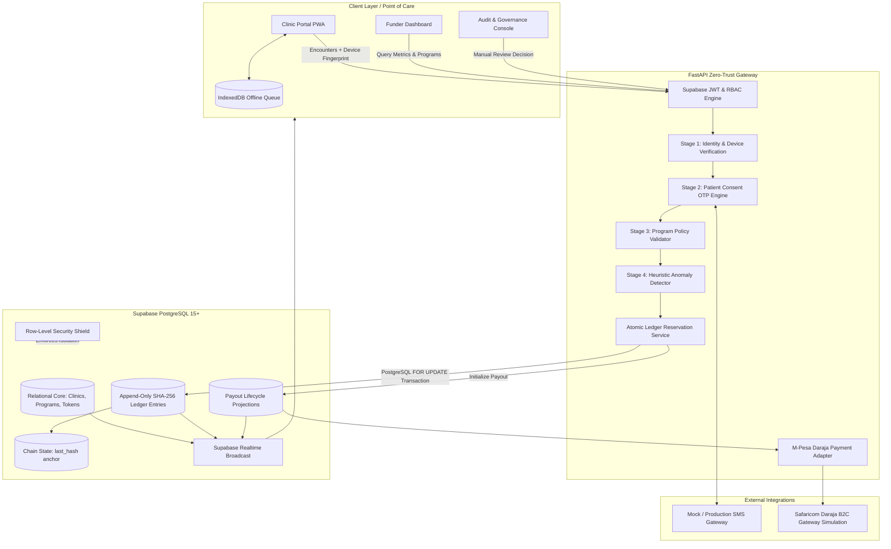
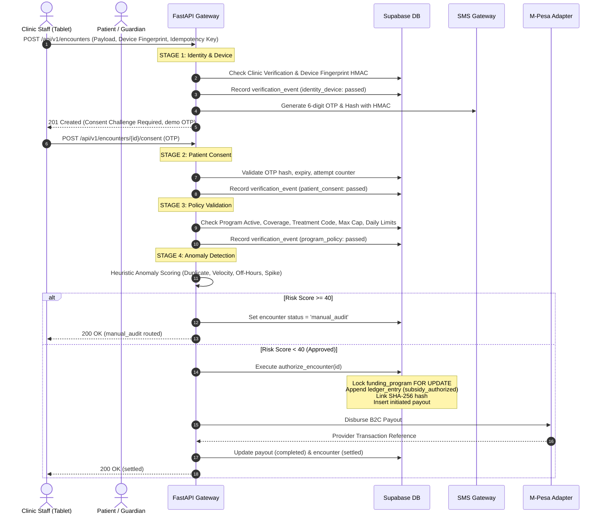

# Nena AI — System Architecture & Engineering Blueprint

**System:** Nena AI Healthcare Subsidy Exchange & Zero-Trust Subsidy Routing Ledger  
**Version:** 2.0 (Phase 2 Modular Architecture)  
**Environment:** Python 3.12, FastAPI, Supabase PostgreSQL, Docker

---

## 1. High-Level Architectural Overview

Nena AI bridges the financial and administrative divide between independent primary care clinics and institutional healthcare funders (NGOs, donor grants, and B2G health initiatives). It guarantees that verified clinical interventions are settled promptly with **zero out-of-pocket costs to vulnerable households**, while providing institutional funders with mathematical proof of service delivery, budget compliance, and real-time impact metrics.

---

## 2. Core Architectural Pillars

### 2.1 The Trusted FastAPI Boundary
The frontend (React PWA) is treated as an untrusted environment. Clinics and devices cannot self-authorize financial disbursements. Every transaction must pass through the trusted FastAPI gateway, which performs:
1. **Cryptographic Token Verification**: Enforces Supabase JWT validity, claims, audience, and non-expired signatures.
2. **Deterministic Organization Isolation**: Enforces tenant boundary so users can only transact within their assigned clinic or funder organization.
3. **Multi-Stage Verification Pipeline**: Validates device fingerprints, patient consent OTP, programmatic rules, and statistical anomaly scores.
4. **Single-Source Atomic Authorization**: Uses PostgreSQL row-level locks (`SELECT ... FOR UPDATE`) to prevent concurrent overspending of funding budgets.

### 2.2 Four-Stage Zero-Trust Verification Engine

---

## 3. Financial Ledger Architecture

### 3.1 Immutable Event Stream vs Mutable Projections
The database enforces a strict separation between immutable financial history and mutable operational state:
- **`ledger_entries`**: An append-only table recording every state transition as a distinct financial event:
  - `subsidy_authorized`: Initial allocation reservation.
  - `settlement_confirmed`: Settlement validated by payment provider.
  - `settlement_failed`: Provider rejected disbursement; triggers reconciliation.
  - `reversal`: Compensating entry that restores uncommitted funding balance.
  - `adjustment`: Approved administrative discrepancy resolution.
- **`payouts`**: A mutable projection tracking provider status (`initiated`, `processing`, `completed`, `failed`, `reversed`), provider transaction IDs, and response payloads.
- **`care_encounters`**: Clinical status tracking (`draft`, `submitted`, `pending_verification`, `approved`, `manual_audit`, `rejected`, `settlement_pending`, `settled`).

### 3.2 Cryptographic Hash Chaining
Every entry inserted into `ledger_entries` triggers `generate_ledger_hash()`:
1. Locks `ledger_chain_state(id=1) FOR UPDATE`.
2. Reads `last_hash` (`prev_hash`).
3. Computes canonical SHA-256:
   $$\text{tx\_hash} = \text{SHA256}(\text{id} \parallel \text{encounter\_id} \parallel \text{program\_id} \parallel \text{clinic\_id} \parallel \text{funder\_id} \parallel \text{event\_type} \parallel \text{amount} \parallel \text{currency} \parallel \text{prev\_hash} \parallel \text{metadata} \parallel \text{created\_at})$$
4. Updates `ledger_chain_state.last_hash = tx_hash`.
5. Rejects any attempt to `UPDATE`, `DELETE`, or `TRUNCATE` `ledger_entries` via PostgreSQL trigger constraints.

---

## 4. Tenant Isolation & Security Boundaries

1. **Role-Based Access Control (RBAC)**:
   - `platform_admin`: Global administrative capabilities.
   - `clinic_admin`: Manages clinic profile, staff accounts, and registered hardware devices.
   - `clinic_staff`: Registers patients, records encounters, verifies OTPs.
   - `funder_admin`: Configures funding programs, sets spending rules, manages capital.
   - `funder_analyst`: Views read-only regional analytics and clinical trends.
   - `auditor`: Conducts manual reviews on flagged claims, inspects cryptographic ledger traces.
2. **Row-Level Security (RLS)**:
   - Supabase PostgreSQL policies restrict all row reads to users with explicit `org_memberships` in the owning organization.
   - Public/anonymous roles have all permissions revoked.
   - Service-role key is isolated strictly within the backend container.
